# ClipBot V2 — Setup Guide

Welcome to ClipBot V2! This guide will walk you through installing the ClipBot Companion, connecting your accounts, configuring your streams, and getting started with Davey AI.

## 1. Download and Install ClipBot Companion

ClipBot V2 is a hybrid SaaS platform that combines cloud services with processing on your own computer.

After signing up and selecting your plan, you'll need to install the **ClipBot Companion** to enable local processing.

From your ClipBot dashboard, click either:

- **Start ClipBot** in the upper-right corner.
- **Companion Setup / Update** in the Streamers tab.

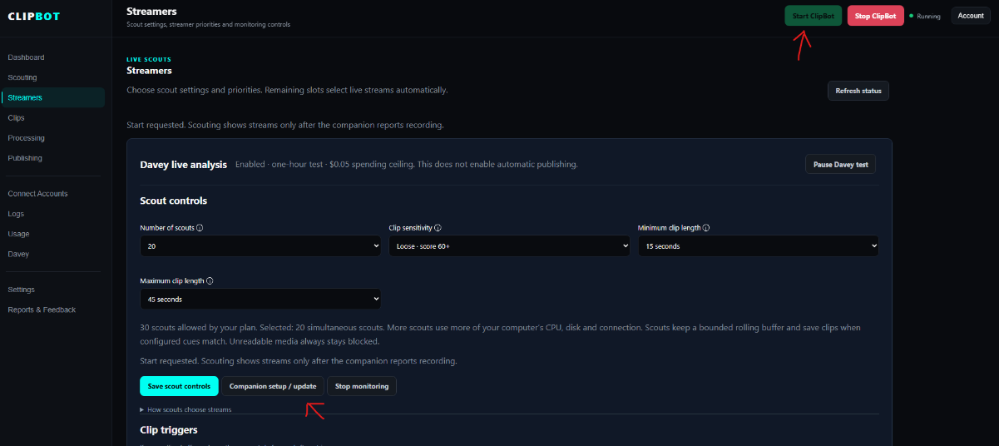

A window will appear prompting you to download the Companion. Click **Download**, then run the installer and follow the on-screen instructions.

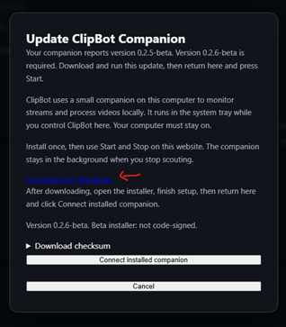

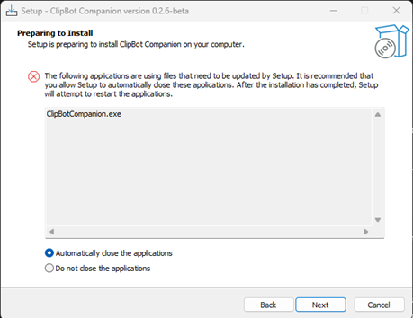

### Troubleshooting Installation Errors

If you encounter an installation error while updating ClipBot Companion:

1. Open **Windows Task Manager**.
2. Locate the running ClipBot Companion process shown below.
3. Select **End Task**.
4. Return to the installer and click **Try Again**.

This issue is more likely to occur during updates than initial installation.

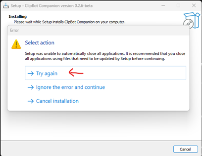

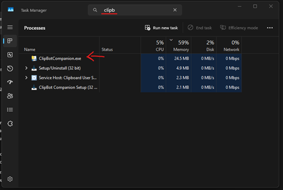

## 2. Pair Your Computer With ClipBot

After installation, your browser may automatically open the ClipBot Companion pairing page.

**Keep this page open until pairing is complete.**

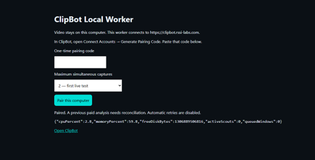

Return to your ClipBot dashboard and close the Companion download window.

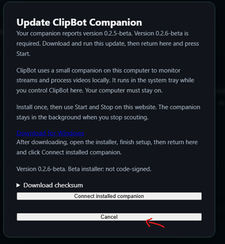

To generate your pairing code:

1. Open the **Connect Accounts** tab.
2. Find the **Local Worker** card.
3. Click **Generate Pairing Code**.
4. Copy the generated code.

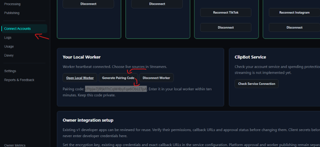

Return to the Companion pairing page, paste your code, and click **Pair This Computer**.

Once pairing succeeds, ClipBot will indicate that your local worker is connected.

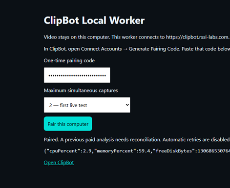

### Verify That Companion Is Running

After pairing, you can close the browser pairing page.

Check your Windows system tray by clicking the arrow near the clock.

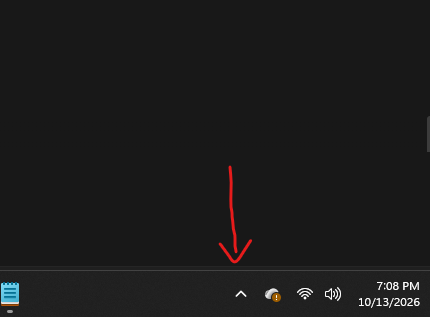

Look for the ClipBot Companion icon.

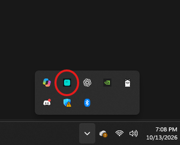

The Companion should remain running in the background while you use ClipBot's local processing features.

## 3. Connect Your Accounts

Return to ClipBot and open **Connect Accounts**.

Here, you can connect your streaming platforms and social media accounts.

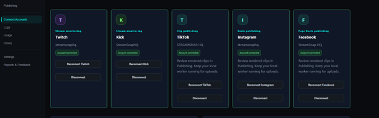

Select the platform you'd like to connect and follow the on-screen instructions.

Some platforms may ask you to select your account type.

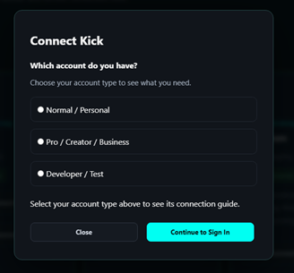

You'll be redirected to the platform's official authorization page.

Review the requested permissions and approve access to connect your account to ClipBot.

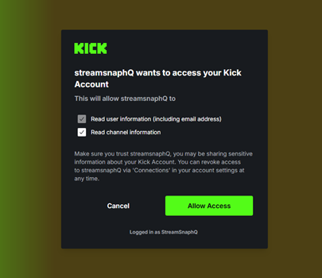

### Twitch and Kick Permissions

Regular Twitch and Kick accounts can connect to ClipBot. Developer accounts are not required for normal users.

If you use a developer account and ClipBot specifically prompts you to configure additional permissions, follow the instructions provided.

ClipBot requests the necessary account permissions during authorization.

After connecting, return to ClipBot and verify the connection status. A green status indicates a successful connection.

If an account does not connect successfully, retry the authorization process.

## 4. Configure Streaming and Clip Detection

Before monitoring your streams:

1. Open the **Streamers** tab and configure your streaming accounts.
2. Set your preferred clip triggers and detection settings.
3. Enable and configure **Davey AI** according to your preferences.

Once configured, click **Start ClipBot** to begin monitoring.

Active streams and monitoring activity can be viewed in the **Scouting** tab.

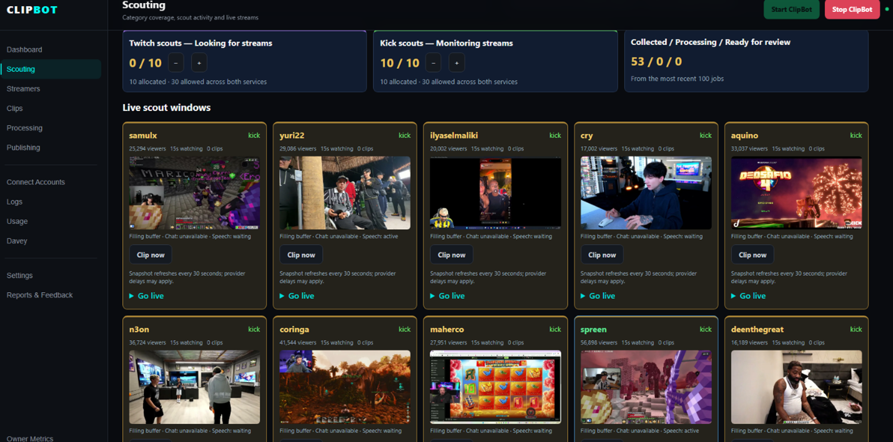

## 5. Logs and Troubleshooting

ClipBot V2 is currently in beta. Your bug reports and feedback help us improve reliability, troubleshoot issues, and refine Davey's performance.

The **Logs** tab contains diagnostic information about your ClipBot sessions.

When you end a session using **Stop ClipBot**, ClipBot generates a bundled diagnostic report that can be downloaded from the Logs page.

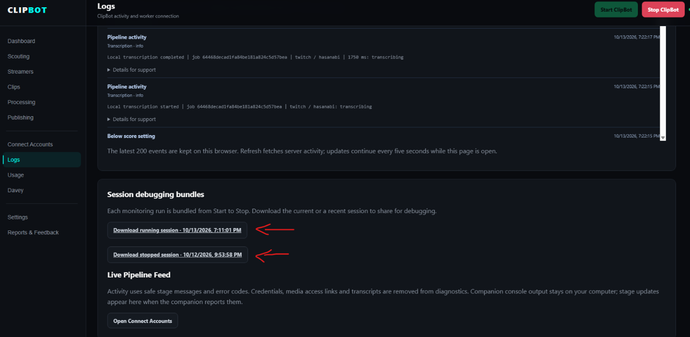

### Reporting an Issue

If ClipBot encounters an error:

1. Note what you were doing when the issue occurred.
2. Click **Stop ClipBot** to end the session and generate the diagnostic bundle.
3. Open the **Logs** tab and download the session bundle.
4. Submit a bug report or contact support with a description of the issue and the relevant logs.

These reports help us identify problems with recording, transcription, clip processing, and other background services.

**Before sharing diagnostic logs, review them for sensitive information such as account details, access tokens, or personal data.**

## 6. Teaching Davey AI

Davey is ClipBot's AI clipping assistant.

As you review generated clips, you can help Davey learn your preferences by providing feedback.

When reviewing clips:

- **Approve** clips you want to keep.
- **Reject** clips that don't meet your expectations.
- **Explain why** you approved or rejected a clip whenever possible.

The more useful feedback you provide, the better Davey can adapt future recommendations to your preferred clipping style.

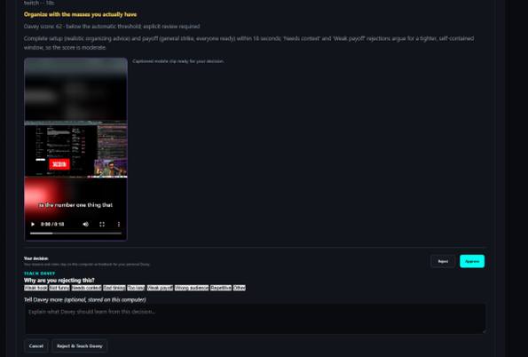

### Davey's Three Learning Modes

Davey is designed around three levels of assistance:

**Learning Mode**

Davey recommends clips and learns from your feedback while you remain in control of approvals.

**Assisted Mode**

Davey handles more of the clipping workflow but still requires your approval before publishing.

**Autonomous Mode**

Once enabled and configured, Davey can publish content automatically within your approved settings and limits.

Visit the **Davey** tab in ClipBot for additional configuration options and information about progressing between modes.

## You're Ready to Use ClipBot!

Once you've installed and paired the Companion, connected your accounts, configured your stream settings, and enabled Davey, you're ready to start monitoring and creating clips.

ClipBot V2 is actively being improved during beta. Please continue submitting feedback and diagnostic reports when issues occur.

Thank you for helping us improve ClipBot!
